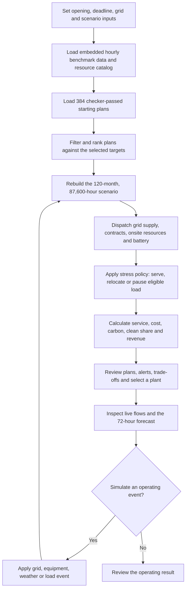

# PeakPower Approach Report

## Executive summary

PeakPower is an interactive screening tool for planning power supply for a fictional data-center campus in Williamson County, Texas. Its main page, `PeakPower.html`, contains the interface, benchmark reference data, a library of candidate plans, and the browser-side hourly simulation. The app follows a three-step workflow: decide when and how to open, review a proposed plant, then inspect and operate the selected plan through live forecasts and event scenarios.

PeakPower makes cost, carbon, service timing, grid limits, and operational response visible together. It is a scenario tool built from benchmark assumptions; it is not a real project quote or a guarantee of uptime.

## Product aspects

1. **Opening and service plan.** Set the campus opening month, full-campus deadline, grid connection timing, wind and solar contract timing, demand growth, weather case, and grid-stress case. PeakPower shows the phased grid import schedule and campus load milestones.
2. **Portfolio and plant design.** Review combinations of grid-delivered wind, solar and nuclear supply with onsite gas turbines, gas engines, fuel cells and a four-hour battery. Supply contracts and merchant imports share the grid connection limit; onsite resources follow their availability, capacity and footprint constraints.
3. **Cost, carbon and business case.** Compare decision cost, cost per MWh, emissions intensity, clean-energy share, contract payments, fuel and equipment costs, and optional tenant revenue or operating margins. Carbon caps and service deadlines can narrow the candidate plans.
4. **Dispatch and flexibility.** Replay hourly demand against available grid imports and generation. The model accounts for battery charging and discharge, movable Tier 1 work, pausable Tier 2 work, and protected Tier 0 load. The UI distinguishes work relocation from interruption and shows the consequences of operator actions.
5. **Live operations.** Inspect site flows, equipment status, alerts, and a 72-hour forecast. Simulate grid or equipment events, weather and demand changes, or backup-generator use to see how the plan responds.
6. **Review and explanation.** The three screens present the opening decision, board-level plant results, and live operation. Charts and summaries expose assumptions, service dates, costs, carbon, stress response, and limitations.

## Implemented approach

PeakPower embeds the benchmark reference-year time series and resource catalog in the HTML file. It also includes **384 pre-simulated candidate plans** that passed the supplied checker. For a selected scenario, its browser-side engine reconstructs the full 87,600-hour horizon and re-dispatches the chosen capacities using transparent operating rules. The page then summarizes energy flows, costs, emissions, service outcomes, and alerts for the selected plan and its alternatives.

The benchmark horizon is 120 model months. It uses the packet’s fictional Texas campus profile, hourly load tiers, wind and solar shapes, electricity and gas prices, resource availability, grid limits, and recurring stress events. Mature load is 75 MW peak and 69 MW average. The reference grid schedule increases import capacity from 0 to 25, 50 and 75 MW at months 18, 24 and 30. Prices are screening assumptions in constant 2023 dollars; the model does not discount costs. The packet inputs are regional proxies and repeated reference-year shapes, not site forecasts.

Dispatch follows rule-based hourly logic rather than a global optimization solver. Wind, solar, and nuclear supply use the shared grid connection; merchant power fills eligible remaining imports. Onsite equipment and storage support the balance. During stress periods, the selected flexibility policy determines whether movable work can relocate and batch work can pause, while protected load remains served locally. The packet accounting includes capacity, contract, fuel, merchant-power, relocation, and interruption costs, plus local and remote emissions. Contract costs apply to available generation even when energy is curtailed. The packet does not allow power sales back to the grid.

The page also labels optional extensions separately from the packet benchmark: tenant-revenue models, annual demand growth, alternate weather years, contract delays, forecast events, and a rented generator priced at $350/MWh with an assumed 0.74 t CO₂/MWh. These extensions are scenario assumptions, not observations from the benchmark.

## Workflow flowchart



## Software structure and run instructions

- **Canonical frontend:** root-level `PeakPower.html`. The Python server returns this file unchanged at `/`, `/index.html`, and `/PeakPower.html`.
- **Python backend:** `data/Contestant_Packet/team_app/server.py` exposes health, recommendation, policy-comparison, and grid-delay endpoints. `engine.py` provides the benchmark recommendation logic and command-line entry point. This service is available separately; the current HTML runs its embedded browser engine and does not call the Python API.
- **Python API model:** the separate Python engine evaluates a documented 14-portfolio candidate set against the supplied checker. Its recommendation endpoint can use the validated default output files. This is a distinct implementation from the HTML’s 384-plan library and should not be presented as if it powers the browser page.

Run from the repository root with Python 3.10 or newer:

```powershell
python -m pip install -r data/Contestant_Packet/starter/requirements.txt
python data/Contestant_Packet/team_app/server.py
```

The local server binds to `127.0.0.1:8000` by default. The browser page is self-contained; the server is used to serve the canonical file and make the separate Python API available.

## Limitations

- The site, commercial offers, and operating scenarios are fictional benchmark assumptions for Texas.
- The benchmark uses regional proxy data and repeats reference-year shapes across the horizon; results are not forecasts.
- The HTML plan library is finite, and dispatch is rule-based. Results are screening comparisons, not proof of a globally optimal portfolio.
- Equipment outages, startups, gas delivery and other real-world operating constraints are simplified or represented only in optional scenarios.
- The root HTML and Python API currently run separate calculation paths. The HTML file is intentionally preserved unchanged; its browser-side results do not come from the Python endpoints.
